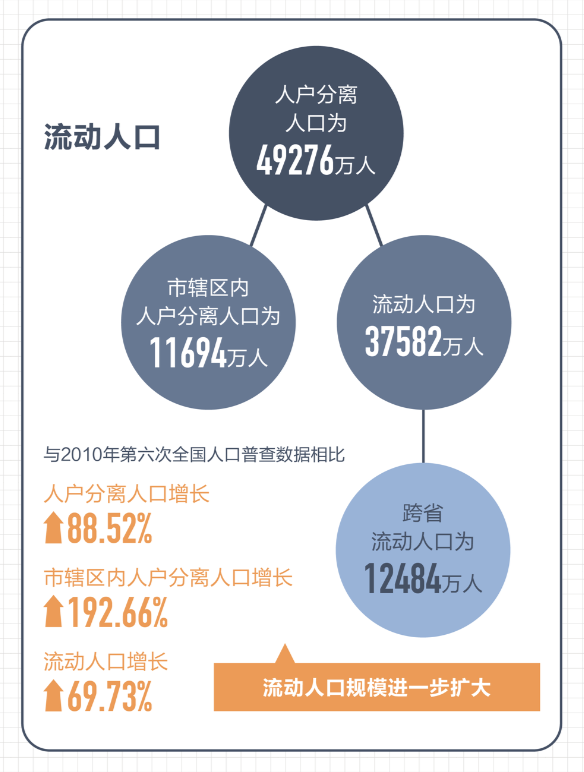

```{r}
#| include: false
#| label: setup
library(pacman)

p_load(
  "icons",
  "tidyverse"
)

set.seed(313)
```

## 提要

1. 问题：城市治理研究的“微观盲区”
1. 进路：治理互动中的个体研究
    - 理论指向 &rarr; 研究设计 &rarr; 实践方向
1. 案例：新老市民 & 流动人口司法

::: {.notes}

20 分钟，四个部分：先讲常规研究缺了什么，再讲这条进路是什么，然后用两项研究演示它如何落地，最后用不平等把两个案例收拢。

:::

# 问题

## 发轫

:::: {.columns}

::: {.column width="40%"}

{fig-align="center" height=420}

:::

::: {.column width="60%"}

{fig-align="center" height=380}

:::

::::

::: {style="text-align:center; margin-top: 1em" .fragment}

制度层面推进“融合”、“一体化”，个体为何仍在[划界]{.red}？

:::

::: {.notes}

2021 年引爆舆论的“ 公交车大妈”：2021 年 5 月 27 日，北京 856 路公交车上，一位老人因让座纠纷辱骂年轻乘客是“外地人”“上北京要饭来了”，并以本地户口自居；6 月 8 日北京公交警方通报其被行政拘留 [@Sina2021Zhenghuangqi]。
2024 年上海地铁的“拳击手阿姨” 事件中,当事人同样凭借本地人身份直白宣称“ 警察只会帮我,不会帮外地人”

七普：全国流动人口 375,816,759 人 （3.76 亿），比 2010 年增长 69.73% [@NBS2021Census7; @Xinhua2021Census7]；按总人口 14.12 亿计约占 26.6%。每四个人里就有一个外来人口

我们自己的研究里问的就是这个问题：为何面向新市民的融入政策在制度层面持续“加码”，微观层面公众的主观认知与行为选择仍然存在偏差 [@HuYueXingYiFei2026]。

:::

## 城市治理研究的三种主流视角

:::: {.columns}

::: {.column width="50%" style="text-align:center"}

**制度与结构**

- 多层级治理、整体性治理
- 分析单元：政府、组织
- 个体 [&rarr;]{.large} 结构节点

:::

::: {.column width="50%" style="text-align:center" .fragment}

**博弈与理性**

- 多主体利益均衡
- 交易成本、激励设计
- 个体 [&rarr;]{.large} 理性原子

:::

::::

::: {style="text-align:center; margin-top: 1em" .fragment}

**技术赋能**

- 数字化转型、应用场景
- 流程再造、绩效改进
- 个体 [&rarr;]{.large} 数据与需求

:::


::: {.notes}

制度与结构：以多层级治理为例，关注层级政府间科层关系、跨市区域合作和政府、市场、公民社会三方结构 [@ZhangXuChenShan2017]。

博弈与理性：城市数字治理中政府、居民、企业之间的博弈均衡 [@ChengHuang2023]。

技术赋能：超特大城市数字化转型的应用场景、技术应用与绩效改进 [@WuMaZhang2025]。

三种视角各有贡献，共同点是个体被简化了：要么是结构里的节点，要么是理性计算者，要么是可编码的需求。

:::

## 微观盲区

:::: {.columns}

::: {.column width="42%"}

- 理论预设：个体 = 理性原子 / 结构节点
- 分析层次：制度 [&rarr;]{.large} [?]{.red} [&rarr;]{.large} 个体响应
- 概念错位：“微观” = 基层、场景 ≠ [个体心理]{.red}

:::

::: {.column width="58%"}

{fig-align="center" height=400}

:::

::::

::: {.fragment}

> Why *psychology rather than economics* could be the key to better intergovernmental relations [@Stoker2010]

:::

::: {.notes}

概念错位的一个例子：有研究把自身推进描述为由宏观建设内容探讨“拓展至微观应用场景分析” [@WuMaZhang2025]，这里的“微观”指应用场景，而不是个体的认知与行为。

Gerry Stoker：英国政治学者，长期任教于南安普敦大学，治理理论的代表人物之一。其《作为理论的治理：五个论点》（Governance as Theory: Five Propositions，1998）是治理研究被引最广的文献之一，另著有《为什么政治重要》（Why Politics Matters，2006）。

原文标题：“The Microfoundations of Governance: Why Psychology Rather than Economics Could Be the Key to Better Intergovernmental Relations”。Stoker 在府际关系研究中提出，治理的微观基础应更多来自心理学而非经济学，并给出两种替代前提：有限理性和内在或道德动机 [@Stoker2010]。

:::

# 进路

## 一种“以人民为中心”的研究进路

城市治理的成效取决于治理互动中[个体]{.red}的认知与行为

::: {style="text-align:center"}

```{mermaid}
%%| fig-width: 10
flowchart LR
  A["治理情境<br/>政策 · 规则"] --> B["个体认知框架<br/>身份 · 地位 · 风险"]
  B --> C1["治理对象<br/>政策评价 · 行为选择"]
  B --> C2["治理主体<br/>决策裁量"]
  C1 --> D["治理结果"]
  C2 --> D
```

:::

::: {.notes}

核心主张：城市治理的成效取决于治理互动中个体（市民与一线治理者）的认知与行为；城市治理研究需要一条以个体为分析单元、跨学科组合理论与方法的微观进路。

“个体”有两类：作为治理对象的市民，以及作为治理执行者的一线治理者。

:::


::: {.callout-note .fragment}

## 与已有进路对话

:::: {.columns}

::: {.column width="50%"}

*继承*

- 行为公共管理：心理学 [+]{.large} 公共管理
- 街头官僚：一线裁量
- 个体认知 [&rarr;]{.large} 治理效果

:::

::: {.column .fragment width="50%"}

*推进*

- [两端]{.red}：治理对象 [+]{.large} 执行者
- [多学科]{.red}组合
- [城市]{.red}作为场景与变量

:::

::::

:::

::: {.notes}

行为公共管理把心理学的洞见引入公共管理 [@GrimmelikhuijsenEtAl2017]；街头官僚研究关注一线执行者的裁量与应对 [@Lipsky1980; @TummersEtAl2015]。

这条进路的推进有三点：同时看治理互动的两端；按问题组合心理学、社会学、法学、经济学的工具；把城市本身作为情境和解释变量。

:::

## 理论指向与研究设计

:::: {.columns}

::: {.column width="50%"}

*不一定要“非理性”*

- 规则、激励 [&rarr;]{.large} 被[认知框架]{.red}处理
- 身份边界：我们 vs. 他们
- 地位感知：社会比较
- 风险感知：秩序与威胁

:::

::: {.column width="50%"}

*学科工具箱*

- 政治心理学：情感理论、有限理性
- 社会学：关系性身份
- 实证法学：司法裁量
- 经济学：语言距离、集聚

:::

::::

::: {.notes}

不说个体“非理性”，而说理性假设不完整：同样的规则和激励，会经过不同的认知框架被处理成不同的反应。

跨学科在研究组合的层面实现：不同议题调用不同学科的工具，而不是每项研究都把所有学科装进去。

:::


::: {.fragment}

```{r}
#| fig-align: center
#| fig-height: 4
#| dev-args:
#|   bg: transparent

library(drhutools)

# Conceptual positions on a 0-1 scale: x = causal identification, y = realism of setting
tab_designs <- tibble(
  design = c("调查实验", "大数据", "田野实验", "面板追踪", "访谈与民族志"),
  caseLabel = c("案例一", "案例二", "", "", ""),
  identification = c(0.80, 0.37, 0.87, 0.57, 0.12),
  realism = c(0.25, 0.80, 0.85, 0.53, 0.95),
  usage = factor(
    c("本报告案例", "本报告案例", "可扩展", "可扩展", "可扩展"),
    levels = c("本报告案例", "可扩展")
  )
)

ggplot(tab_designs, aes(identification, realism)) +
  # Quadrant guides at the midpoint of each axis
  geom_hline(yintercept = 0.5, linetype = "dashed", color = "grey75") +
  geom_vline(xintercept = 0.5, linetype = "dashed", color = "grey75") +
  geom_point(aes(color = usage, shape = usage), size = 7, stroke = 1.8) +
  geom_text(
    aes(label = design),
    vjust = 2.6,
    size = 6,
    family = "Microsoft YaHei"
  ) +
  geom_text(
    aes(label = caseLabel),
    vjust = 5.2,
    size = 4.5,
    color = "grey40",
    family = "Microsoft YaHei"
  ) +
  scale_color_gb("main", discrete = TRUE) +
  scale_shape_manual(values = c(16, 1)) +
  scale_x_continuous(limits = c(0, 1), breaks = NULL) +
  scale_y_continuous(limits = c(0, 1.05), breaks = NULL) +
  labs(
    x = "内部有效性",
    y = "情境真实性",
    color = NULL,
    shape = NULL
  ) +
  theme_minimal(base_family = "Microsoft YaHei", base_size = 18) +
  theme(
    panel.grid = element_blank(),
    axis.line = element_line(
      arrow = arrow(length = unit(0.25, "cm")),
      color = "grey30"
    ),
    legend.position = "bottom",
    plot.background = element_rect(fill = "transparent", color = NA)
  )
```

:::


::: {.notes}

"关注变量：认知身份、文化因素。实心点为两个案例所用设计，空心点为可扩展设计；位置为相对示意，非测量值。来源：作者自绘。"

进路不绑定某一种设计。两个案例分别使用了调查实验和基于裁判文书的计算社会科学方法；最后一行是这条进路可以延伸的方向，本报告的两个案例并未使用。

每种设计都有自己的识别前提：调查实验依赖随机化成功和组间均衡；文书数据的观察性回归依赖控制可观测因素后不存在遗漏混杂。

- 可用方法：
  - 调查实验：情境操纵 [&rarr;]{.large} 因果识别
  - 大数据：文本挖掘 [&rarr;]{.large} 真实决策
  - 田野实验、面板、访谈与民族志

设计谱系图为示意：横轴是内部有效性（因果识别），纵轴是情境真实性，各设计的位置是相对的，不是测量值。实心点为两个案例所用设计，空心点为可扩展的设计。

:::

## 实践方向：两端的认知反应

:::: {.columns}

::: {.column width="50%"}

*治理对象*

- 政策 [&rarr;]{.large} 被如何理解？
- 谁感到[被比较]{.red}？

:::

::: {.column width="50%"}

*治理执行者*

- 规则 [&rarr;]{.large} 被如何裁量？
- 谁被[区别对待]{.red}？

:::

::::

::: {style="text-align:center; margin-top: 1em" .fragment .large}

期待政策评估纳入[个体认知反应]{.red}指标

:::

::: {.notes}

共同命题：治理设计要预判政策在治理对象和执行者两端引起的认知反应。

这是从两项研究推出的实践命题，不是研究直接检验的发现。

:::

# 案例一：老市民的“凝视”

[@HuYueXingYiFei2026]

## 问题与设计

- 研究问题：老市民如何“看”新市民？[&rarr;]{.large} 如何影响政策态度？

:::: {.columns}

::: {.column width="50%"}

*理论*

- 身份是[关系性]{.red}的
- 群体威胁 [&rarr;]{.large} 排斥
- 市民身份 = 潜在上位身份

:::

::: {.column width="50%"}

*设计*

- CVS 2021、2022 调查实验
- 全国配额样本，n = 2009 / 2419
- 认知身份：14 岁前是否迁入

:::

::::


::: {.notes}

身份在本质上是关系性的，群体通过定义“他者”定义自身 [@Cerulo1997]；群体互动直接生成新的身份认知 [@HoggEtAl2017]；移民在规则与文化上对本地主流的冲击引发群体威胁 [@BurnsGimpel2000]。

实验一：第三人称情境实验，“小 L”分别为新市民、农民、老市民，测量先赋身份（身高、健康）与后赋身份（社会地位）等评价。实验二：社会比较实验，实验组被引导回想对本市新市民的印象。

样本为线上配额抽样，参照七普按地区、城乡、年龄、性别配额，不等同于概率样本 [@HuYueXingYiFei2026]。

:::

## 发现一：“凝视”的存在

:::: {.columns}

::: {.column width="55%"}

{fig-align="center" height=450}

:::

::: {.column width="45%"}

*老市民 vs. 新市民* (评价同一对象)

- 新市民：[无差异]{.grayLight}
- 老市民：地位、自信 [&uarr;]{.blue}
- 但开心程度 [&darr;]{.red}

:::

::::

::: {.notes}

图为“老市民小 L”减“新市民小 L”的评价差。新市民被试在各维度上没有显著差异，说明新市民已在认知上与老市民看齐；老市民被试仍认为“老市民小 L”的社会地位和自信心更高，这就是“老市民凝视”。差异幅度不大，属于细微但一致的区分。

“一高一低”：老市民自认禀赋和地位更高，日常生活满意度却更低 [@HuYueXingYiFei2026]。

:::

## 发现二：“凝视”的后果

:::: {.columns}

::: {.column width="55%"}

{fig-align="center" height=400}

:::

::: {.column width="45%"}

*回想新市民之后*

- 老市民：人才政策评价 [&darr;]{.red}
- 新市民：[人才政策评价]{.grayLight}
- 新老市民：子女留本地 [&darr;]{.red}
- 新市民比例低的城市更明显

:::

::::

::: {.notes}

回想新市民显著降低了老市民对本地人才政策的评价，新市民的变化不显著。

子女发展建议为二分变量（本地或附近城市 vs. 其他城市）。按摘要口径：凝视降低了新老市民期望子女留居本地的意愿（设计记录 2026-10-13：正文与结论的方向表述有误）。

异质性：在新市民占比低于 30% 的城市，老市民的政策评价与留居意愿效应更明显 [@HuYueXingYiFei2026]。

:::

::: {.callout-important}

## 案例一的治理含义

- 融入政策只看新市民,  老市民的反应被忽视
- 凝视不随代际更替自然消解

::: {style="text-align:center" .fragment}

*单向赋权 &rarr; [双向激活]{.red}*

:::

:::


::: {.notes}

作者的政策含义：不仅要强调对新市民的赋权激活与主动融入，也要强调对老市民的赋权与激活，变“单向赋权”为“双向激活” [@HuYueXingYiFei2026]。

:::

# 案例二：流动人口司法

[@WangXiangHuYue2026]

## 问题与设计

- 研究问题：司法对流动人口是[约束]{.red}还是[包容]{.blue}？

:::: {.columns}

::: {.column width="50%"}

*理论*

- 焦点关注：[维护地方稳定]{.red}
- 社会认同：文化相近 [&rarr;]{.large} 接纳
- 发展诉求：城市需要人口

:::

::: {.column width="50%"}

*设计*

- 裁判文书，2020 至 2021 年
- [164,790]{.red} 份，282 个地级市
- 机器学习 + NLP 抽取情节
- 城市、年份双向固定效应

:::

::::

::: {.notes}

焦点关注理论：法官量刑围绕应受谴责性、对社区的保护、量刑的实际影响三类焦点 [@SteffensmeierEtAl1998]；本文切入点是“对社区的保护”。社会认同：个体更认同与自身相似的群体 [@HoggTerry2000]。

数据：中国裁判文书网基层法院一审刑事判决，分层抽样 16 类常见案由，只保留有期徒刑案件；人工核验 6000 份，F1 = 0.873。文化距离用方言距离测量，发展诉求用城市规模等级测量 [@WangXiangHuYue2026]。

:::

## 发现一：约束效应

:::: {.columns}

::: {.column width="55%"}

{fig-align="center" height=500}

:::

::: {.column width="45%"}

*同类案件*

- 流动人口 [&rarr;]{.large} 刑期 [&uarr;]{.blue}
- 控制案内、案外因素后稳健
- 显著但幅度[有限]{.red}：仅约 10 天

:::

::::

::: {.notes}

流动人口被告的判决刑期更长，β = 0.34，p < 0.05。刑期单位为月，0.34 个月约 10 天；样本刑期均值 23.3 个月，差异约为均值的 1.5%。统计上显著，实质幅度有限，台上主动说明。

作者的解释：这是司法部门对社会稳定责任的专门反应 [@WangXiangHuYue2026]。

:::

## 发现二：包容效应

{fig-align="center" height=450}

:::: {.columns}

::: {.column width="50%"}

- 文化距离：[倒 U 形]{.red}
- 拐点 ≈ 方言区边界

:::

::: {.column width="50%"}

- 发展诉求：[U 形]{.red}
- 拐点 ≈ 特大城市

:::

::::

::: {.notes}

流动人口子样本：文化距离一次项 1.15、二次项 −0.61，均 p < 0.01，拐点约在“同一方言区不同方言片”；发展诉求一次项 −1.28（p < 0.01）、二次项 0.09（p < 0.05），临界点在城市规模第 6 级（特大城市）。

城市发展诉求还调节了约束效应（流动人口 × 发展诉求，β = −0.002，p < 0.01）；流动人口 × 文化距离的交乘项不显著 [@WangXiangHuYue2026]。

方言距离的倒 U 形是否反映认知或身份机制，仍有待微观行为数据检验，这也是作者自述的局限。

:::

## 案例二的治理含义

::: {style="text-align:center; margin-top: 2em"}

> 司法包容性 ≠ [纵容]{.red}

:::

- 差异化对待 = 约束 [+]{.large} 包容的共存
- 裁量回应文化差异与发展诉求

::: {.notes}

作者认为，不能简单将这种差异化判决归咎为司法不公正；“司法包容性”并非对犯罪行为的纵容，而是对社会多元性的观照；司法决策不应仅强调“照章办事”，更应关注犯罪背后的文化差异与经济诉求 [@WangXiangHuYue2026]。

:::

## 总结与启示

1. 城市治理研究存在[微观盲区]{.red}
2. 治理互动的[两端]{.red}：市民与一线治理者
3. 认知框架连接[制度与行为]{.red}

**理论贡献**：以个体[认知框架]{.red}打开制度与响应之间的黑箱<br>
**实践启示**：政策评估纳入两端的认知反应<br>
**学科视角**：按问题实现多视角、跨学科联合研究

::: {.fragment style="text-align:center; margin-top: 2em"}

> [人民城市人民建，人民城市为人民。]{.red .large}

::: {.large style="text-align:right"}

—— @Xinhua2019PeopleCity

:::

:::


::: {.notes}

讲话场景：2019 年 11 月 2 日下午，习近平在上海考察期间来到杨浦滨江公共空间杨树浦水厂滨江段，沿滨江栈桥察看黄浦江两岸风貌。他指出，这里原来是老工业区，见证了上海百年工业发展，如今“工业锈带”变成了“生活秀带”，人民群众有了更多获得感和幸福感；人民城市人民建，人民城市为人民。城市建设要贯彻以人民为中心的发展思想，合理安排生产、生活、生态空间，扩大公共空间，让老百姓有休闲、健身、娱乐的地方 [@Xinhua2019PeopleCity]。这是“人民城市”理念的首次完整提出，2022 年写入党的二十大报告。

“人民城市”的提法把城市治理的落点放在人身上 [@HeYanling2024]。微观进路要回答的，正是人民城市中的“人”如何感知、如何回应。

:::

# 感谢倾听，敬请指正 {background="#43464B"}

:::{style="text-align: right; margin-top: 1em"}

[`r feather_icons("github")`&nbsp; sammo3182](https://github.com/sammo3182)

[`r feather_icons("mail")`&nbsp; yuehu@tsinghua.edu.cn](mailto:yuehu@tsinghua.edu.cn)

[`r feather_icons("globe")`&nbsp; https://sammo3182.github.io/](https://sammo3182.github.io/)

{height=250}

:::

## 参考文献

::: {#refs}

:::

# 附录 {.appendix visibility="uncounted"}


## 不平等：动因与结果 {visibility="uncounted"}

:::: {.columns}

::: {.column width="50%"}

*案例一*：不平等作为[动因]{.red}

:::

::: {.column width="50%"}

*案例二*：不平等作为[结果]{.red}

:::

::::

```{mermaid}
%%| fig-width: 10
flowchart LR
  A["结构性不平等<br/>户籍 · 地位 · 地域"] --> B["认知框架<br/>地位比较 · 文化距离"]
  B --> C["个体行为<br/>政策评价 · 司法裁量"]
  C --> D["差异化对待<br/>再生产或缓冲"]
  D --> A
```

::: {.notes}

案例一：感知到的地位差异与社会比较，驱动老市民对人才政策的负面评价。

案例二：一线治理者的认知框架，产出对流动人口的差异化司法对待；文化距离与城市发展诉求又可能缓冲这种差异。

两个案例在闭环的不同位置上，说明同一条进路既能解释不平等如何塑造行为，也能解释行为如何生产或缓冲不平等。措辞用“差异化对待”，不用“不公”。

:::

## 研究议程 {visibility="uncounted"}

:::: {.columns}

::: {.column width="50%"}

*跨议题*

- 福利保障、公共服务
- 社会治理、基层治理
- 其他治理形式

:::

::: {.column width="50%"}

*跨方法*

- 微观行为数据
- 身份变化、偏好变化、行为变化
- 呼唤混合方法

:::

::::

::: {.notes}

案例一作者提出可将实验情境拓展到住房保障、公共服务、社区治理 [@HuYueXingYiFei2026]；案例二作者提出需结合更多微观行为数据与定性资料探索司法决策机制 [@WangXiangHuYue2026]。

:::
