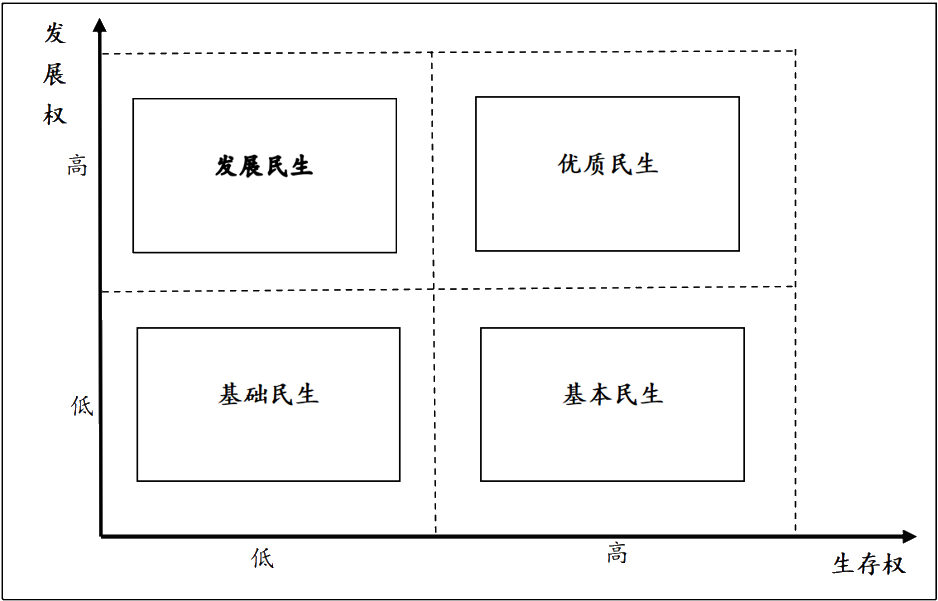
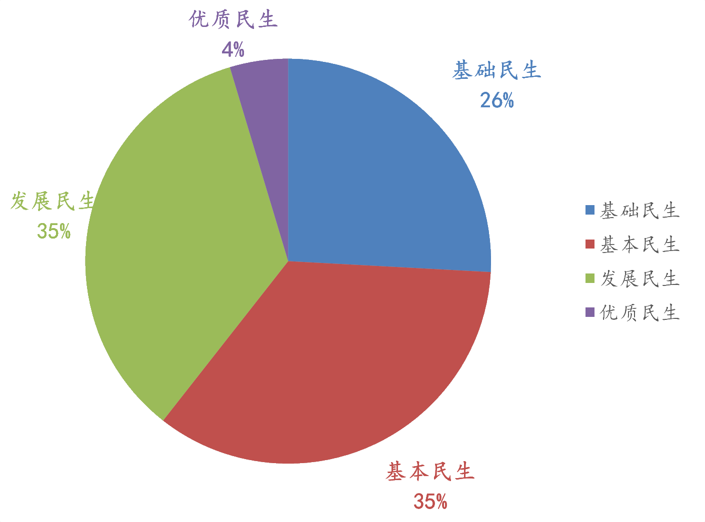

```{r setup}
#| include = FALSE

library(pacman)

p_load(
  "icons",
  "tidyverse",
  "lubridate",
  "drhutools"
)

# Functions preload
set.seed(313)
```

## 个人简介{.Small}

:::: {.columns}

::: {.column width="60%"}
*个人经历*

- 政治[科学]{.red}博士[（University of Iowa)]{.small}
  - 信息学[（Graduated Certificate in Informatics)]{.small}
- 清华大学计算社会科学平台[(副主任)]{.small}
  - 清华数据与治理中心[(副主任)]{.small}
  - 计算社会科学编程语言证书项目[（负责人）]{.small}

*研究兴趣*：*认知、行为与现代性*

- **W. 数据科学**
  - 实验室和调查实验
  - 潜变量分析、网络分析、空间分析
  - 文本大数据分析、数据可视化
:::

::: {.column width="40%"}
*研究领域*

- **W. 心理学**
  - 政治[认知与行为]{.red}
  - 政治传播
  - 身份政治（城乡、司法）
- **W. 经济学**
  - 社会经济不平等[感知]{.red}
- **W. 语言学**
  - 语言能力的政治影响
  - 语言政策的[治理功能]{.red}

:::

::::

## 概要

:::{style="text-align:center; margin-top: 2em"}

- 数据性质与价值
- 数据分析的计算社会科学视野
- 政务（大）数据分析方法与应用
- 政务（大）数据分析迷思与原则

:::

# 数据性质与价值

## 大数据 &rarr; 社会科研

:::{style="text-align:center"}
什么是**大数据**
:::

:::: {.columns}

::: {.column width="35%"}
{fig-align="center" height=500}
:::

::: {.column width="30%"}
人类社会的“*快速、大尺度、深层次*”数字化转型

- 社会数字化---[海量]{.red}资源待处理
- 数据科学---计算机[辅助]{.red}方法
- 新生现象---[新]{.red}理论、新范式
:::

::: {.column width="35%"}
{fig-align="center" height=500}
:::

::::

:::{.notes}
Nature column: 
Science special issue: 

拍字节或拍它字节（Petabyte、PB）是一种信息计量单位，现今通常在标示网络硬盘总容量，或具有大容量的保存媒介之保存容量时使用。

1PB = 1,000 TB (兆) = 1,000,000 GB (十亿)，所以中文的全称是：1千兆
:::

## 政务数据的来源

:::: {.columns}

::: {.column width="50%"}
*（政务）数据来源*

1. 电子政务、公务电话热线、政民互动数据
2. 各机构和部门的官方数据
3. 演讲、声明
4. 传统和新媒体
5. 官方文件档案
6. 司法文件
......
:::

::: {.column width="50%"}
*目标*

1. 议程的启动
2. 政策制定者的概况
3. 政策制定过程
4. 政策决策和执行的逻辑
5. 政策评估
6. 政策结果的预测
......
:::

::::

## 大数据优势



## 大数据特点

:::: {.columns}

::: {.column width="35%"}
> 大数据是指需要新处理模式才能确保更强的决策力、洞察力和流程优化力的海量、高速增长和多样化的信息财富 [@GartnerHiebl2017]
:::

::: {.column width="65%"}
{fig-align="center" height=600}
:::

::::

## 战略视野下的数据价值

- 大数据是以容量大、类型多、存取速度快、应用价值高为主要特征的数据集合，正快速发展为对数量巨大、来源分散、格式多样的数据进行采集、存储和关联分析，从中发现新知识、创造新价值、提升新能力的[新一代]{.red}信息技术和服务业态。（国务院 2015）
- 数据已成为国家[基础性战略资源]{.red}（十三五）
- 数据是重要[生产要素]{.red}（十九届四中全会）
- 加快构建数字技术[辅助政府决策]{.red}机制，提高基于[高频大数据精准动态监测预测预警]{.red}水平。强化数字技术在公共卫生、自然灾害、事故灾难、社会安全等突发公共事件应对中的运用，全面提升预警和应急处置能力。(十四五)


## 认知视野下的数据价值

> 数据是新的石油 ---克莱夫·亨比 (2006)    
> 世界上最宝贵的资源不再是石油而是数据 --- 经济学人（2017）

价值是指人们对于某种事物或概念认为重要、有意义、有用或有吸引力的[程度]{.red}。价值在经济学中[通常与稀缺性相关]{.red}。

:::{.notes}
- Clive Humby @Arthur2013, Data is the new oil, 英国数学家和data science 企业家
- @TheEconomist2017, The world's most valuable resource is no longer oil, but data
:::

|        	| 排他                                                  	| 非排他                                  	|
|--------	|-------------------------------------------------------	|-----------------------------------------	|
| **竞争**   	| *私有产品*： <br>食物、石油、普通制成品、私人池塘里的鱼等。 	| *公共资源*： <br>森林、矿山、海洋中的鱼等。 	|
| **非竞争** 	| *俱乐部产品*： <br>卫星电视、私人公园等。<br>| *公共产品*： <br>国防、航空、阳光、新闻等。 	|


## 数据价值独特性 [@Liu2021a]

:::: {.columns}

::: {.column width="70%"}
{fig-align="center" height=600}

:::{.notes}

数据不是新的石油


- 估值困境
    - 石油是有限资源
    - GDP只能测量有固定价格产品
    - 数据：无限复制，不同组合价值也不一样

- 管理困境
    - 石油需要管道运输
    - Data regulation: overdue, regulatory overkill, risk management or overreaction
    
- 使用困境
    - 分析什么和如何分析，以计算社会科学为例
:::

:::

::: {.column width="30%"}
- 估值困境：数据意识
- 管理困境：数据政策
- 使用困境：数据方法
    - 数据价值是[分析]{.red}出来的
    - E.g., 计算社会科学
:::

::::

:::{style="text-align:center"}
> 信息具有价值，但[不经提纯则无法使用]{.red}。  
---迈克尔·庞莫（2006）  
> 信息是21世纪的石油，[分析是内燃机]{.red}。  
---彼得·桑德加德（2011）
:::

:::{.notes}
- "Information is the oil of the 21st century, and analytics is the combustion engine." senior vice president and global head of Research at Gartner, Inc, a speech given by Mr. Sondergaard at the Gartner Symposium/ITxpo in October, 2011 in Orlando, Florida. @Singh2023

- @Palmer2006, Data is just like crude. It’s valuable, but if unrefined it cannot really be used. 
:::

## 小结

- 大数据定义
  - 体量大、消极数据
- 大数据特点
  - Volume, velocity, variety, variability, veracity, value
- 数据价值
    - 战略视野下价值
    - 认知视野下价值
      - 估值困境
      - 管理困境
      - 使用困境


# 数据分析的计算社会科学视野

## 数据科学

{fig-align="center" height=600}


## 数据科学发展沿革

```{r dsHist, dev = "png", dev.args=list(bg="transparent")}
# df_event_en <- tribble(
#   ~event, ~date, ~type,
#   'Information entropy', 1948, 'concept',
#   'The Future of Data Analysis', 1962, 'concept',
#   'Relational Database', 1970, 'system',
#   'Data science', 1974, 'milestone',
#   'Two-Way Communication', 1975, 'concept',
#   'Exploratory Data Analysis', 1977, 'concept',
#   'Business Intelligence', 1989, 'system',
#   'The First Database Report', 1992, 'system',
#   'The World Wide Web Explodes', 1995, 'milestone',
#   'Data Mining and Knowledge Discovery', 1997, 'concept',
#   'S(ACM Software System Award)', 1998, 'system',
#   'Statistical Modeling: The Two Cultures', 2001, 'concept',
#   'Hadoop', 2006, 'system',
#   'Data scientist', 2008, 'milestone',
#   'NOSQL', 2009, 'system',
#   'Deep Learning', 2015, 'system',
#   'Transformer', 2017, 'system',
#   'ChatGPT', 2022, 'milestone'
# ) |>
#   mutate(date = as.Date(paste(date, '/12/31', sep = '')))

df_event <- tribble(
  ~event, ~date, ~type,
  '信息熵', 1948, 'concept',
  '“数据分析的未来”', 1962, 'concept',
  '关系型数据库', 1970, 'system',
  '数据科学', 1974, 'milestone',
  '信息双向传递', 1975, 'concept',
  '探索性数据分析', 1977, 'concept',
  '商业智能', 1989, 'system',
  '水晶报表', 1992, 'system',
  '互联网爆发', 1995, 'milestone',
  '《数据挖掘与知识探索》', 1997, 'concept',
  'S(ACM Software System Award)', 1998, 'system',
  '“统计模型：两种文化”', 2001, 'concept',
  '离线分布计算Hadoop', 2006, 'system',
  '数据科学家', 2008, 'milestone',
  '非关系型数据库', 2009, 'system',
  '深度学习', 2015, 'system',
  'Transformer', 2017, 'system',
  'ChatGPT', 2022, 'milestone'
) |>
  mutate(date = as.Date(paste(date, '/12/31', sep = '')))

df_event$position <- rep_len(c(0.5, -0.5, 1.0, -1.0, 1.5, -1.5), length.out = nrow(df_event))

df_year <- data.frame(date = seq(
  from = as.Date('1948-01-01'),
  to = as.Date('2022-12-31'),
  by = "1 year"
)) |>
  mutate(year = year(date))

df_year$year[-seq(1, nrow(df_year), 4)] <- ''

ggplot(data = df_event) +
  geom_segment(aes(x = date, y = 0, xend = date, yend = position)) +
  geom_hline(yintercept = 0, color = "black", linewidth = 1) +
  geom_label(
    aes(x = date, y = position, label = event, color = type, size = 16),
    show.legend = FALSE
  ) +
  geom_point(aes(x = date, y = 0, color = type),
             size = 3, show.legend = FALSE
  ) +
  geom_text(
    data = df_year,
    aes(x = date, y = 0, label = year), 
    size = 3.5, vjust = 2
  ) +
  theme_void()
```

:::{.notes}
https://bjt.name/2018/11/18/timeline.html

Information entropy, 1948

由信息论之父 C. E. Shannon 在论文《A Mathematical Theory of Communication 》提出。Shannon 借用热力学的原理解决了 Uncertainty 的测量性问题。（太早，故未在时间轴上体现）

The Future of Data Analysis, 1962

John W. Tukey 也是个人最为崇拜的统计学家（除了祖师爷 Fisher 以外），Tukey 讨论了两个有意思的问题：

统计学和数据分析的关系
统计学和计算机学的关系
大家有兴趣可以搜一下原文，感受一下 56 年前大佬的思考深度。

Data science, 1974

Data science 的概念是 Peter Naur 在《Concise Survey of Computer Methods》首次提出，Peter Naur 是计算机科学家，图灵奖的获得者。 在这本书里，Peter Naur 给了偏计算机领域的数据定义：

Data is a representation of facts or ideas in a formalized manner capable of being communicated or manipulated by some process.

Peter Naur 对 computer science 这个词很有意见，建议应该叫做 datalogy 或者 data science，当然和现代 data science 的定义还是差别很大。

Two-Way Communication, 1975

由日本邮政和通信省主导，在这次信息社会普查发现：信息（数据）的传递不是单向的，双向（个性化）的是未来的趋势。

Exploratory Data Analysis, 1977

这个词学统计的应该非常清楚是什么意思，不多讲。Tukey 在 1977 年就提出来这个观点，让我们这些后辈只有佩服的份。

Business Intelligence, 1989

Howard Dresner 赋予了商业智能以现代概念：

concepts and methods to improve business decision making by using fact-based support systems

The First Database Report, 1992

Crystal Reports (水晶报表)，较晚一些从事数据科学的童鞋可能没听过这款产品。想想那是 1992 年，能够在 Windows 上通过连接数据库形成一个数据报告是多么酷的事情。

The World Wide Web Explodes, 1995

互联网技术和应用开始井喷式爆发，我们面临的以及需要优化的问题是人类社会前所未有的，同时提供给了数据科学更多的可能性。

Data Mining and Knowledge Discovery, 1997

聚焦在数据挖掘的权威期刊，包括基础理论、数据挖掘方法、数据挖掘算法、知识发现过程、应用等。Data mining 这个词是表示了从大型数据库中提取信息之意。

S(ACM Software System Award), 1998

S 语言由贝尔实验室的 John Chambers 发明，在 1998 年被授予 ACM 软件系统奖。这是唯一的数据科学领域被授予奖项的系统，它永久的改变了人们分析数据的方式，是探索性数据分析的集大成之作。

Statistical Modeling: The Two Cultures, 2001

Leo Breiman 在该论文中提到：在使用统计模型从数据中提取结论的过程中有两种文化。一个假定数据是由一个特定分布模型生成的。另一个使用算法模型，并把数据结构看作未知的。统计学界普遍致力于仅仅使用针对数据的模型。这种投入产生了无意义的理论、值得怀疑的结论，并让统计学家无法触及大量现实问题。算法模型，在理论与实践中，在统计学之外快速发展。它既可以被应用于庞大复杂的数据集，也可以在小数据集上建立精确信息量大的模型。如果我们这个领域的目标是使用数据解决问题，那么我们需要摆脱对纯粹基于数据模型的依赖，并使用更多样的工具。

Hadoop, 2006

离线分布式计算的基石，且免费，对硬件的要求不高。因为它的存在，所有机构都可以用较小的成本来处理海量的数据。记得 2011 年之后，国内讲大数据如果不讲 Hadoop 就感觉非常不专业的样子。

Data scientist, 2008

Jeff Hammerbacher (Facebook) 和 DJ Patil (LinkedIn) 开始使用数据科学家来描述他们的团队以及工作。从此以后，数据科学家这个名词开始广泛地被提起。

NOSQL, 2009

非关系型数据库，其口号是：

select fun, profit from real_world where relational=false;

Deep Learning, 2015

深度学习其实并不是什么新鲜技术，人工神经网络在 20 世纪 50 年代就出现了，但是受限于算力和要求的数据量，神经网络发展一直相对缓慢。2015 年随着 Google 在语音识别领域精度的极大提高（几项比赛的革命性效果），深度学习再一次火了起来。
:::

## 什么是社会科学 {.scrollable}

> 社会科学是用[科学的方法]{.red}，研究人类社会的种种现象。

:::: {.columns}

::: {.column width="20%"}
- 政治学
- 经济学
- 社会学
- 国际关系
- 心理学
- 行政学
- 军事学
- 统计学
- 人类学
- 民俗学
- 公共关系学
- 公共行政学
- 犯罪学
- 考古学
- 教育学
- 语言学
- 社会工作
- 新闻学
- 传播学
- 宗教学
- 图书馆学
- 区域研究
- 发展研究
- 环境研究
- 性别研究
- 媒体研究
……
:::

::: {.column .fragment width="60%"}
{fig-align="center" height=500}
:::

::: {.column .fragment width="20%"}
- 马克思主义理论
- 法学
- 历史
:::

::::


## 计算社会科学{.smaller}

> “计算社会科学”这一研究领域正在兴起，人们将在前所未有的深度和广度上[自动]{.red}地收集和利用数据，为社会科学的研究服务。社会计算是指社会行为和计算系统[交叉融合]{.red}而成的一个研究领域，研究的是如何利用计算技术帮助人们进行沟通与协作，如何[利用计算技术研究社会运行的规律与发展趋势]{.red}。

:::{.r-hstack}
{fig-align="center" height=400}

{fig-align="center" height=400}
:::

## 学科交叉

- @LazerEtAl2009： 15位美国学者在*Science*上联合发表里程碑意义文章"Computational Social Science"
- @Hey2009：“第四范式”，大数据时代的科学研究不再需要模型和假设，而是利用超级计算能力直接分析海量数据发现相关关系即可获得知识
  - Empirical evidence
  - Scientific theory
  - Computational science
  - Data-intensive research
- @King2016: 大数据方法将终结传统的定量、定性方法分野

## 计算·社会科学

{fig-align="center" height=num}

## 新交叉学科

从海量数据中利用机器学习抽离出有价值的信息

:::: {.columns}

::: {.column width="50%"}
- 积累海量数据
- 利用统计和数学知识 + 模式识别技术
- 发现有意义的新关系、新模式或新趋势
:::

::: {.column width="50%"}
- [数据来源拓展]{.red}：文本、图片、视频、空间地理……
- [工具箱拓展]{.red}:  机器学习
- [研究问题拓展]{.red}：大规模、复杂问题、新生议题

:::

::::

## 数据分析层次

:::{style="text-align:center; margin-top: 2em"}

描述分析
（数据科学手段）

↓

关系分析
（计量经济学手段）

↓

模式/规律学习
（社会科学手段）

↓

因果推断
（跨学科手段）

:::

:::{.notes}
因果推断：统计学、经济学、计算机等
:::


## 描述

全球 Covid-19

<iframe src="https://ourworldindata.org/explorers/coronavirus-data-explorer?tab=map&facet=none&Metric=Confirmed+deaths&Interval=7-day+rolling+average&Relative+to+Population=true&Color+by+test+positivity=false&country=USA~ITA~CAN~DEU~GBR~FRA~JPN&hideControls=true" loading="lazy" style="width: 100%; height: 500px; border: 0px none;"></iframe>

---

Standardized World Income Inequality Database (Solt 2020)

<iframe src="https://fsolt.shinyapps.io/SWIIDweb" style="border: none; width: 100%; height: 550px; border: 0px none;"></iframe>


## 关系分析  {auto-animate=true}

{fig-align="center" height=600}


## 模式学习  {auto-animate=true}

:::{.r-hstack}
{fig-align="center" height=500}

{.fragment fig-align="center" height=500}
:::

## 规律学习

{fig-align="center" height=600}

## 因果推断

{fig-align="center" height=600}


## 举例：孔子学院关闭的因果效应

:::: {.columns}

::: {.column width="50%"}
+ 得到[Google Jigsaw](https://jigsaw.google.com/)的支持
+ 监控全球100多种语言的广播、印刷和网络新闻[无处不在]{.red}
+ 变量：人物、地点、组织机构、主题、来源、情感、计数、引语、图像和事件

:::{.notes}
Jigsaw is a unit within Google that explores threats to open societies, and builds technology that inspires scalable solutions.
:::
:::

::: {.column width="50%"}
{fig-align="center" height=600}
:::

::::

## Shutting-down vs. Ice cream

:::{.r-hstack}
{fig-align="center" height=600}

{fig-align="center" height=600}
:::

## 推断结果

{fig-align="center" height=600}

## 小结

- 大数据的分析价值：计算社会科学的产生
- 计算社会科学 = 数据科学 + 社会科学
- 数据分析的层次
  - 描述
  - 关系
  - 模式/规律
  - 因果


# 政务（大）数据分析方法与应用

## 大数据研究方法

:::{style="text-align:center; margin-top: 2em"}
- 自然语言处理
- 机器学习
- 音频/视频/图片分析
- 社会网络分析
- 空间/时间分析    
……

:::

## 自然语言处理(Natural Language Processing)

- 语言（自然语言）是人类获得信息和表达信息的重要载体之一
  - 计算语言学：NLP是使用自然语言与计算机进行通信的技术——从语料中产生知识
    - 信息抽取、实体识别、词性标注、句法分析、语音识别、机器翻译、自动文摘、信息检索等
    - 语言模型：描述自然语言内在规律的数学模型
    - 向量空间模型(Vector Space Model)、统计语言模型（N-gram）、字符嵌入(word embedding)

## 文化组学

- 指通过电子化文本的量化分析研究[人类行为与文化趋势]{.red}的计算词典学方法，以研究人们使用的语言与词汇，进而揭示其中反应出来的文化现象。

{fig-align="center" height=500}


:::{.notes}
“文化组学”一词是2010年创造的新词，由英文中的“文化”（culture）与“组学”（omics）二词合并而成，@MichelEtAl2011 当年《自然》上发表首次提出了该词.

米歇尔与埃登还参与了Google实验室的项目Google Ngram Viewer。这个项目通过n元语法（n-gram）分析Google图书中的数据，以展示语言中的文化模式随时间的变化。
:::


## 机器学习

> 通过计算机编程实现比人工检索更[好]{.red}的效果 [@Samuel2000]。

:::: {.columns}

::: {.column width="50%"}
{fig-align="center" height=600}

:::{.notes}
Generative pre-trained transformers; GPT
:::
:::

::: {.column width="50%"}
1. 收集数据
1. 数据准备
1. 选择一个模型
1. 训练
1. 评估
1. 参数调整
1. 预测
:::

::::


## 视频/图片分析[@GebruEtAl2017]

:::{.r-stack}
{fig-align="center" height=600}

{.fragment fig-align="center" height=600}
:::


:::{.notes}
accurately estimate income, race, education, and voting patterns with single-precinct resolution using data from a census of motor vehicles, which enumerated 22 million automobiles in total (8% of all automobiles in the US)； regional level 

:::


## 社会网络分析

:::{.r-stack}
{fig-align="center" height=600}

{.fragment fig-align="center" height=600}
:::


:::{.notes}
美国政党1949-2011

Edges between nodes are drawn if each member agrees with another member more often than the "threshold value" of votes specific to that particular Congress. The threshold value is the number of agreements where any pair exhibiting this number of agreements is equally likely to comprised of two members of the same party (e.g. D-D or R-R), or a cross-party pair (e.g. D-R). 
:::

## 空间分析

{fig-align="center" height=600}

:::{.notes}
总，服务类，管理类，安保类
:::

## 时间分析

:::{.r-stack}
{fig-align="center" height=600}

{.fragment fig-align="center" height=600}
:::

:::{.notes}
通过交通量衡量quarantine效果
:::

## 时空比较

:::{.r-hstack}
{fig-align="center" height=600}

{fig-align="center" height=600}
:::

## 时空分析

{fig-align="center" height=600}


## 政务大数据分析应用

:::{style="text-align:center; margin-top: 2em"}
- 商情通：城市营商环境大数据动态感知平台
- 民情通：人感城市智慧决策辅助系统
:::

## 商情通：城市营商环境大数据动态感知平台

[建设营商环境大数据动态感知平台，加速构建创营商环境新优势。]{.red}通过打破政府数据壁垒，建立汇集基层政府治理、市场营造和企业发展等多维度数据信息系统平台，助力政府发现市场监管缺口和企业市场需求提供依据，进一步解决城市社会经济发展新要求。

:::{style="text-align:center; margin-top: 2em"}
*指标设计原则*：

1. 时代性与本土性原则；
1. 多样性与代表性原则；
1. 可靠性与时效性原则。
:::


## {.smaller}

| **一级指标** | **设置目标**                     | **指标内涵**                                   |
|----------|------------------------------|--------------------------------------------|
| 1.政府治理   | 衡量营商环境建构                     | 与营商环境发展相关涉的制度建设和司法实践、廉政建设、城市安全等方面          |
|          | 过程中的政府法治                     |                                            |
|          | 建设和城市运行情况                    |                                            |
| 2.市场营造   | 衡量地方在服务市场商事主体、应对相关营商问题上的综合能力 | 涉及政府回应、劳动保障、基础运维、市场监督和经济纠纷化解等市场营造问题的地方应对能力 |
| 3.企业经营   | 衡量地方营商环境对企业发展的综合影响           | 促进以企业为代表的商事主体的生存、规模、经营水平的提升情况              |

## 商情数据驾驶舱

{fig-align="center" height=400}

[整合司法大数据、网络舆情大数据、政务热线大数据、企业营商大数据等]{.red}数据资源，在此基础上进行大数据分析展示，分析营商热点，挖掘民声民意，以便快速的做出工作的响应。

## 案例：基于大数据分析的广州市营商环境评估研究

:::: {.columns}

::: {.column width="60%"}
- 项目受托方：中国发展研究基金会、广州市发改委。
- 课题成果：
  - 以广州为中心个案，通过挖掘和说明政府、市场和企业维度下不同指标的营商环境意涵及其变动趋势特征，实现以把脉问诊形式评估2021年度广州营商环境的整体特征。
  - 以商情通的数据分析模块为依托，将时间颗粒度细化到月和日，对广州下辖的不同行政区县进行营商环境测量与评估。
:::

::: {.column width="40%"}
{fig-align="center" height=600}
:::

::::

## 民情通：人感城市智慧决策辅助系统

数字时代智慧城市的两种模式:

- 物感城市（城市大脑、智慧城市、数字孪生）
    - 感知城市的客观世界、物理空间
    - 以物为中心、强技术依赖、运行成本高、中心化结构
- 人感城市（接诉即办、市长直通车、粤省心）
    - 感知城市的主观世界、社会空间
    - 以人为中心、市民参与驱动、成本社会化、扁平化结构
    - 物感城市+人感城市：理解城市复杂系统的解决方案


## 人感城市 vs. 物感城市


| **感应方式** | **物感城市**   | **人感城市**   |
|----------|------------|------------|
| **驱动来源** | 数字技术、物感数据  | 市民诉求、人感数据  |
| **感知范畴** | 物理系统、现象与行为 | 社会系统、意义与情感 |
| **参与主体** | 政府、科技企业    | 政企社多主体协同   |
| **治理结构** | 中心化、串联式    | 扁平化、并联式    |
| **优先目标** | 城市高效运行     | 以人民为中心     |

## 敏捷治理

建成市民诉求驱动的城市治理决策辅助系统，辅助政府[感知社情民情，精准科学决策，促进政府回应效能升级]{.red}。通过统筹规划、分步实施，逐步实现数据整合、业务融合，形成动态化决策辅助体系、开发自动化决策辅助报告平台，全面提升社会治理的数字化与智能化水平，赋能基层敏捷治理改革。

{fig-align="center" height=400}

## 人感闭环

{fig-align="center" height=600}

## 治理创新

{fig-align="center" height=600}

## 人感城市的探索：北京“接诉即办”改革{.smaller}

{fig-align="center" height=300}

十八届三中全会：“全面深化改革的总目标是完善和发展中国特色社会主义制度，[推进国家治理体系和治理能力现代化]{.red}”。

- 2017年，“街乡吹哨，部门报到”
- 2018年，“吹哨集合”改革试点
- 2019年，“吹哨报到”全面铺开城市治理现代化改革
- 2019年，“接诉即办”政务热线大数据成为超大城市治理抓手
- 2020年，“接诉即办”升级，启动地方立法
- 2021年，《北京市接诉即办工作条例》，市民诉求驱动的治理革命

## 链接市民与城市

“市民诉求驱动”超大城市治理：市民诉求数据体量巨大

- 数据质量可靠：有事投诉、办事回应、督察回访
- 民情诉求多样：市场服务、社会风险、民生服务
- 群体覆盖广泛：积极市民、用户多样、底线保障

{fig-align="center" height=300}

## 市民诉求驱动

- 业务流程优化：围绕市民诉求，重塑回应流程
    - 以专业分工为基础的“串联式业务流程”-以市民诉求为中心的“并联式业务流程”
    - 政民互动关系：感知汇聚民意，事前主动回应
- 主动识别民生问题的“矛盾集中点”、“关键风险点”和“病因产生点”，推动社会治理端口前移，从“被动回应”向“主动回应”转变
    - 考核激励机制：量化回应过程，激发回应动力
- 推动“眼睛向上”的科层逻辑，转向“眼睛向下”的现代服务型政府

## 接诉即办全流程

{fig-align="center" height=600}

## 人感数据：12345+网格化+社交媒体

:::{.r-stack}
{fig-align="center" height=600}

{.fragment fig-align="center" height=600}
:::

## 城市感知:数据穿透

:::{.r-hstack}
{fig-align="center" height=600}

{fig-align="center" height=600}
:::

## 回应性评估

{fig-align="center" height=600}

## 干预效果评估

{fig-align="center" height=600}

## 问题诊断

{fig-align="center" height=600}

## 问题鉴别

{fig-align="center" height=600}

## 风险评估

:::{.r-hstack}
{fig-align="center" height=600}

{fig-align="center" height=600}
:::


## 小结

:::: {.columns}

::: {.column width="50%"}
### 方法

- 自然语言处理
- 机器学习
- 音频/视频/图片分析
- 社会网络分析
- 空间/时间分析
:::

::: {.column width="50%"}
### 应用

- 商情通
- 民情通
:::

::::


# 政务（大）数据分析迷思与原则

## 大数据分析迷思{.larger}

:::{style="text-align:center; margin-top: 2em"}
1. 创新性迷思
2. 伦理性迷思
3. 合理性迷思 
:::

## 创新性迷思

[{fig-align="center" height=200}](https://www.computerworld.com/article/3162030/microsofts-big-data-like-study-on-sleep-proves-what-doctors-already-know.html)

[{fig-align="center" height=200}](https://www.independent.co.uk/voices/gender-pay-gap-worst-offenders-government-targets-diversity-disability-equality-a8788341.html)

问题导向 + 多元整合 + 社会科学思维


## 伦理性迷思

[{fig-align="center" height=600}](https://www.ftc.gov/news-events/press-releases/2019/09/google-youtube-will-pay-record-170-million-alleged-violations)

:::{.notes}
FTC（美国联邦贸易委员会）和纽约州总检察长指控YouTube频道在未经父母同意的情况下收集儿童个人信息用于定向广告。
:::


## 歧途：诱导

{fig-align="center" height=600}

:::{.notes}
2018年Facebook数据泄露事件：Facebook在2015年就发现剑桥分析公司非法获取大量用户隐私数据用于政治广告投放，但为何没有及时告知用户，直到今年媒体曝光才承认？

剑桥分析助选
:::


## 歧途：误导




## 合理性迷思

:::{style="text-align:center; margin-top: 1em"}
“每日上亿条”

“全网数据”

“《人民日报》所有文章”
:::

:::{.fragment .r-fit-text}
大数据[不是]{.red}全数据

全数据[不一定是]{.red}好数据
:::


:::{.notes}
1. 贵
1. 没必要
1. 可信度呈疑
:::

## 破除合理性迷思

遵守

:::{style="text-align:center; margin-top: 2em"}
数据收集原则

研究设计原则

人才培养原则
:::


## 数据收集：抽样

从[一大堆]{.blue}到[一小撮]{.red} &rArr; 代表性


:::{.notes}
随机抽样的代表性体现在一定的sample size上
:::


::::{.columns}
:::{.column width="40%" .fragment}
**简单随机抽样**

+ SHA算法和MD5
+ 计算机随机数

:::{.notes}
计算机伪随机数

真随机数：物理现象，如内存、硬件、噪音
:::
:::

:::{.column width="60%" .fragment}
**复杂抽样**

*设计*

+ 配额（quota）
+ 分组（clustering）
+ 分层（stratification）

:::
::::

## 复杂抽样

:::{.r-hstack}

{fig-align="center" height=600}

{fig-align="center" height=600}

:::
:::{.notes}
Stratification: 分类，每类中随机抽取，每类成员在总体中配比不变        
Clustering：直接随机抽取一类        
Quota：成分配比够就行，不用随机
:::


## 数据收集合理性

> @KingEtAl2017a： 为了系统地描述他们的观点，我们从2010年到2015年的社交媒体帖子中获取了一个随机样本...... 从这些数据中，我们[抽取了]{.red}128个帖子，这些帖子是由人们......

> @CironeHobbs2022:  该分析仅限于[随机样本]{.red}的推文，我们收集了手工标注的数据......


- 简单和复杂抽样是否适用于政务大数据？
- 抽样偏差、数据来源冲突、波动增加、误差率...
- "Let data talk"?

## Data Never Talks

{fig-align="center" height=600}

:::{.notes}
数据来源冲突：数据源问题

Hansen, Lars Peter. 2019. “Purely Evidence-Based Policy Doesn’t Exist.” Chicago Booth Review. http://review.chicagobooth.edu/economics/2019/article/purely-evidence-based-policy-doesn-t-exist（2019年3月27日）。
:::


## 研究设计原则：科学性

> [[综合性决策部署要考虑方方面面的差异性，专项性决策部署要找准在全局中的合理定位，这些都需要充分熟悉情况、深入分析论证、**科学把握尺度**。]{.red .large}    

:::{style="text-align:right"}
——习近平 (《中央政治局的同志必须有很强的看齐意识》, 2015年12月）
:::


:::{.fragment style="text-align:center; margin-top: 2em"}
如何科学？

**信念**

程序    
方法
:::


## 研究程序

::::{.columns style="text-align:center; margin-top: 1em"}
:::{.column width="50%"}
### 问题导向

1. [问题]{.red}提出
1. 理论[假设]{.red}
1. 数据[方法]{.red}
1. 实证[检验]{.red}

:::

:::{.notes}
Jim Gray 早在2006 年就发表了题为《第四范式：数据密集型科学发现》：实验范式、理论范式、仿真范式、Data-Intensive Scientific Discovery
:::

:::{.column width="50%"}
### 数据导向&star;

1. [观察]{.red}数据
1. [分析]{.red}方法
1. [规律]{.red}总结
1. 理论[提升]{.red}

:::
::::


## 研究指向

::::{.columns}
:::{.column width="50%" .fragment}
*描述*

已知 &rArr; 未知

1. 无偏（正确😄）
1. 高效（准确😅）

{fig-align="center" height=400}
:::

:::{.column width="50%" .fragment}
*机制*

搞清why & how

......

but how?

{fig-align="center" height=400}

:::
::::


## 人才培养原则

1. 知识基础
1. 软硬件基础
1. 认知基础

## 知识基础

典型对话：

> 负责人：我想在项目中使用大数据方法。我应该怎么做？

> 顾问：去学Python吧！！




## 知识基础

{fig-align="center" height=600}


## 硬件基础

::: {.panel-tabset}
### 原生数据

:::{style="text-align:center; margin-top: 1em"}
* 网站HTML
* RSS feeds
* 网络社交媒体
* 网络交易行为    
……
:::

### 社交媒体

{fig-align="center" height=600}

:::{.notes}
新浪微博1.4亿，微信用户5.5亿;
微信日增数据500TB，QQ日增数据200TB。
:::

### 公共开放平台

{fig-align="center" height=600}

### 网络问政平台

{fig-align="center" height=600}

### 社会化问答网站

{fig-align="center" height=600}

:::{.notes}
Quora, Stack Overflow
:::

### 媒体数据库

{fig-align="center" height=600}

### 问卷开放性问题

{fig-align="center" height=600}

### 档案数据

* 中国知网等数据库（期刊、报刊、年鉴等）
* Google Books、百度学术
* Google Trend、百度指数
* JSTOR Data for Research……

:::

## 软件基础

:::: {.columns}

::: {.column width="50%"}
**Python > R**

- API ports
- Automation tools
- Commercial usage

:::

::: {.column width="50%"}

**R > Python**

- Analysis
- Visualization
- Ecology

:::

::::

## 认知基础

{fig-align="center" height=600}


## 小结

:::: {.columns}

::: {.column width="50%"}

*大数据分析迷思*

1. 创新性迷思
    - “新瓶”与“旧酒”
2. 伦理性迷思
    - 诱导与误导
3. 合理性迷思 


:::

::: {.column width="50%"}
*破除合理性迷思*

- 数据收集原则
    1. 代表性原则
    1. 大数据抽样

- 研究设计原则
    1. 科学：信仰 + 程序 + 方法

- 人才培养原则
    1. 知识基础
    1. 软硬件基础
    1. 认知基础
:::
::::

# 感谢关注，欢迎交流 {background="#43464B"}

:::{style="text-align: right; margin-top: 1em"}  
[`r feather_icons("github")`&nbsp; sammo3182](https://github.com/sammo3182)

[`r feather_icons("mail")`&nbsp; yuehu@tsinghua.edu.cn](mailto:yuehu@tsinghua.edu.cn) 

[`r feather_icons("globe")`&nbsp; https://www.drhuyue.site](https://www.drhuyue.site)

{height=250}
:::

## 参考文献